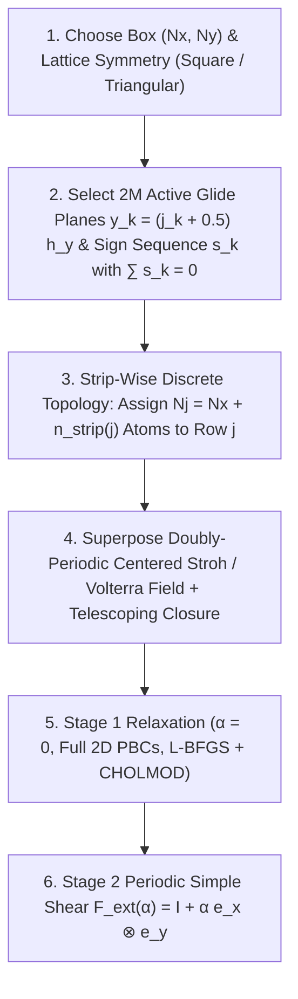

# Mathematical Formulation and Practical Guide: Installing Edge Dislocations in the Mesoscopic Tensorial Model (MTM)

> [!IMPORTANT]
> **Purpose & Scope**
> This document establishes the complete mathematical foundation, discrete topological construction, doubly-periodic continuum displacement superposition, and two-stage relaxation/loading protocol for installing **edge dislocations** in 2D Square ($C_4$) and Triangular ($C_6$) crystals within the Mesoscopic Tensorial Model (MTM). Every equation maps directly to the C++ solver ([`MacroscopicGeometry.cpp`](../src/MacroscopicGeometry.cpp), [`DislocationDisplacement.h`](../include/DislocationDisplacement.h), [`zanzotto_examples.cpp`](../src/experiments/zanzotto_examples.cpp)) and the macOS studio ([`MacroscopicGeometryModels.swift`](../LatticeLauncher/Sources/MacroscopicGeometryModels.swift), [`GeometryBuilderView.swift`](../LatticeLauncher/Sources/GeometryBuilderView.swift)).

---

## 1. Overview of the Two Dislocation Installation Modes

The codebase provides two complementary methods for nucleating and studying edge dislocations with Burgers vector $\mathbf{b} = \pm a_0\,\hat{\mathbf{e}}_x$:

| Feature | Mode A: Multi-Plane Periodic Torus (`periodic_dislocations`) | Mode B: Single-Dislocation Cylinder (`volterra`) |
| :--- | :--- | :--- |
| **Domain Topology** | Full 2D Periodic Torus $\mathbb{T}^2 = [0, L_x) \times [0, L_y)$ (square or rectangular $N_x \times N_y$) | Circular or square domain of radius $R_{\text{free}}$ centered on a single core |
| **Dislocation Count** | $2M$ dislocations ($M$ balanced $\pm b$ pairs), **strictly 1 dislocation per active glide plane** | $1$ single edge dislocation at the origin $(0,0)$ |
| **Vertical $\pm b$ Sign Order** | **Arbitrary order in $y$** (Random shuffled, Grouped $+ \dots + / - \dots -$, or Alternating $+ - + -$) with $\sum_{k=1}^{2M} b_k = 0$ | Single core ($+a_0$ or $-a_0$) |
| **Topological Mechanism** | Explicit strip-wise discrete atom insertion/removal ($N_j = N_x + n_{\text{strip}}(j)$) | Continuous branch-cut displacement jump $\Delta u_x = b$ across the negative $x$-axis |
| **Boundary Conditions** | **Full 2D Periodic BCs** (all $N_{\text{total}}$ nodes free; zero artificial wall locking) | Outer annulus $r > R_{\text{free}}$ locked to analytical Volterra/Stroh far field |
| **Mechanical Loading** | Stage 1 core relaxation ($\alpha = 0$) $\to$ Stage 2 homogeneous periodic shear $\mathbf{F}_{\text{ext}}(\alpha)$ | Static core structure or macroscopic Cauchy stress relaxation ($\boldsymbol{\sigma}_{\text{macro}} \to \mathbf{0}$) |
| **Primary C++ Implementation** | [`MacroscopicGeometryConfig::generatePeriodicDislocationLattice`](../src/MacroscopicGeometry.cpp) | [`NonSingularDisplacement::calculateEdgeDisplacement`](../include/DislocationDisplacement.h) |

---

## 2. Mode A: Multi-Plane Single-Dislocation Periodic Setup ($\mathbb{T}^2$)

In Discrete Dislocation Dynamics (DDD) and mesoscopic crystal plasticity, one often wishes to introduce $2M$ edge dislocations distributed across $2M$ distinct horizontal glide planes—**strictly one dislocation per active glide plane**—inside a fully doubly-periodic rectangular domain $[0, L_x) \times [0, L_y)$.



### 2.1 Topological Neutrality & Why a Single Plane Cannot Hold One Dislocation in 2D PBCs

By Stokes' theorem on a 2D periodic torus $\mathbb{T}^2 = \mathbb{R}^2 / (L_x \mathbb{Z} \times L_y \mathbb{Z})$, the net Burgers circuit around the boundary of the fundamental periodic cell $[0, L_x) \times [0, L_y)$ must vanish identically because opposite edges of the cell are identified:

$$
\oint_{\partial([0, L_x) \times [0, L_y))} d\mathbf{u} = \sum_{k=1}^{K} \mathbf{b}_k = \mathbf{0}.
$$

In a discrete Bravais lattice where atoms sit on horizontal rows $j \in \{0, 1, \dots, N_y - 1\}$:
1. An edge dislocation with Burgers vector $\mathbf{b}_k = s_k a_0\,\hat{\mathbf{e}}_x$ ($s_k \in \{+1, -1\}$) on the horizontal glide plane $y_k = (j_k + 0.5)h_y$ (between row $j_k$ and row $j_k + 1$) corresponds to a discrete mismatch of **1 lattice spacing** ($+1$ atom per period $L_x$ above vs. below the glide plane when $s_k = +1$).
2. Because every individual atomic row $j$ wraps periodically around $x \in [0, L_x)$, row $j$ must contain an **integer** number of atoms $N_j \in \mathbb{Z}^+$.
3. Across glide plane $k$, the integer atom count between row $j_k$ and row $j_k + 1$ jumps by:
   $$
   N_{j_k + 1} - N_{j_k} = s_k \in \{+1, -1\}.
   $$
4. Consequently, a single glide plane cannot contain a net $+a_0$ dislocation unless another glide plane elsewhere in the box carries $-a_0$ so that the atom count returns to $N_0 = N_x$ across the vertical periodic boundary $y = L_y \equiv 0$:
   $$
   \sum_{k=1}^{2M} s_k = 0 \implies N_{N_y} = N_0 + \sum_{k=1}^{2M} s_k = N_x.
   $$

Thus, by placing **1 dislocation per active glide plane** across $2M$ distinct glide planes ($M$ planes with $s_k = +1$ and $M$ planes with $s_k = -1$), every active glide plane contains an isolated single dislocation while the global crystal is topologically compatible with full 2D periodic boundary conditions.

---

### 2.2 Discrete Strip-Wise Lattice Construction & Arbitrary Vertical Sign Order

Let $a_0 > 0$ be the equilibrium nearest-neighbor spacing of the active interatomic/continuum potential (computed via [`ZanzottoPotential::findOptimalLatticeParameter`](../include/Potentials.h)), and let the vertical inter-row spacing be:

$$
h_y = \begin{cases}
a_0 & \text{(Square Lattice, } C_4\text{)} \\[6pt]
\dfrac{\sqrt{3}}{2}\,a_0 & \text{(Triangular Lattice, } C_6\text{, } N_y \text{ even)}
\end{cases}
$$

so the periodic box periods are:

$$
L_x = N_x\,a_0, \qquad L_y = N_y\,h_y.
$$

> [!NOTE]
> **Even-$N_y$ Requirement for Triangular Lattices**:
> In a Triangular ($C_6$) crystal, successive horizontal rows alternate their horizontal phase by $\delta_{\text{row}}(j) = 0.5\,(j \bmod 2)\,a_0$ ($ABAB\dots$ stacking). For row $j = N_y - 1$ (`B` layer) to bond periodically with row $j = 0$ (`A` layer) across $y = L_y \equiv 0$, $N_y$ must be **even**. If an odd `ny` is requested in Triangular mode, [`generatePeriodicDislocationLattice`](../src/MacroscopicGeometry.cpp) and [`SimulationConfig.buildArguments`](../LatticeLauncher/Sources/SimulationConfig.swift) automatically increment `ny` to `ny + 1`.

#### Step 1: Torus-Centered Glide Plane Rows
Let $2M$ active glide planes be indexed by $0 \le j_0 < j_1 < \dots < j_{2M-1} \le N_y - 2$. For equispaced layouts, the planes are centered on the periodic torus at:

$$
j_k = \operatorname{round}\!\left((k + 0.5)\frac{N_y}{2M} - 0.5\right), \qquad y_k = (j_k + 0.5)\,h_y, \qquad k = 0, 1, \dots, 2M - 1.
$$

This guarantees that the vertical distance across the periodic boundary between plane $2M - 1$ and plane $0$,

$$
\Delta y_{\text{wrap}} = (N_y - j_{2M-1} + j_0)\,h_y \approx \frac{L_y}{2M},
$$

equals the interior spacing $\Delta y = (j_{k+1} - j_k)h_y \approx L_y / (2M)$ (e.g., for $N_y = 100$ and $2M = 6$, planes sit at $j \in \{8, 25, 41, 58, 75, 91\}$).

#### Step 2: Cumulative Strip Atom Count & Arbitrary Vertical Sign Order
For each atomic row $j \in \{0, 1, \dots, N_y - 1\}$ at baseline height $Y_j = j\,h_y$, the cumulative topological excess is the sum of Burgers signs of all active glide planes below $Y_j$:

$$
n_{\text{strip}}(j) = \sum_{k \,:\, j_k < j} s_k, \qquad N_j = N_x + n_{\text{strip}}(j).
$$

Because $n_{\text{strip}}(j)$ depends only on the partial sum of signs below row $j$:
- **Alternating $+b / -b$ order in $y$ is NOT required**: Any vertical permutation of $M$ positive signs ($+1$) and $M$ negative signs ($-1$) satisfies $\sum_{k=0}^{2M-1} s_k = 0 \implies N_{N_y} = N_0 = N_x$.
- **Physical interpretation of different vertical sign sequences**:
  1. **Random Shuffled Order (`equispaced_random_signs` / `random_planes_random_signs`)**: Randomly permutes the $M$ positive ($+a_0$) and $M$ negative ($-a_0$) signs across the $2M$ glide planes (e.g. `+ + - + - -`), providing an unbiased DDD-style initial microstructure.
  2. **Alternating Order (`alternating_random_x` / `alternating_staggered`)**: Sets $s_k = (-1)^k$, keeping $n_{\text{strip}}(j) \in \{0, +1\}$ so every horizontal strip has either $N_x$ or $N_x + 1$ atoms and long-range axial compression/tension is minimized.
  3. **Grouped Dipole Band (`grouped_dipole_band`)**: Places all $M$ positive dislocations on the lower $M$ planes and all $M$ negative dislocations on the upper $M$ planes (`+ + ... + - - ... -`). In the central strip ($j_{M-1} < j \le j_M$), $n_{\text{strip}}(j) = +M$, so those rows contain $N_j = N_x + M$ atoms—physically representing $M$ extra vertical half-planes terminating in the central band (a dipolar tilt/pile-up band with local background compression $\bar{\varepsilon}_{xx} = -M / N_x$).

#### Step 3: Half-Integer Cell-Center Baseline Coordinates
In row $j$, the $N_j$ atoms have uniform baseline spacing $a_j = L_x / N_j$ and are placed at half-integer cell centers:

$$
\bar{X}_{i,j} = \big(i + 0.5 + \delta_{\text{row}}(j)\big)\frac{L_x}{N_j}, \qquad Y_j = j\,h_y, \qquad i = 0, 1, \dots, N_j - 1,
$$

where:

$$
\delta_{\text{row}}(j) = \begin{cases}
0 & \text{(Square Lattice)} \\[4pt]
0.5\,(j \bmod 2) & \text{(Triangular Lattice)}
\end{cases}
$$

Placing the leftmost atom of row $j$ at $\bar{X}_{0,j} \approx 0.5\,a_0$ and the rightmost atom at $\bar{X}_{N_j-1,j} \approx L_x - 0.5\,a_0$ ensures that adding the elastic displacement $u_x(\bar{X}_{i,j}, Y_j)$ never causes boundary atoms to wrap across $x = 0 \leftrightarrow L_x$, preserving straight left and right edges on the primary fundamental domain.

---

### 2.3 Doubly-Periodic Anisotropic Stroh / Isotropic Volterra Displacement Field

Because the integer atom count $N_j = N_x + n_{\text{strip}}(j)$ already supplies the topological slip jump $\Delta u_x = b_k$ across glide plane $y_k$ and the mean strip strain $\bar{\varepsilon}_{xx}(j) = -n_{\text{strip}}(j)/N_x$, the superimposed continuum displacement field $\mathbf{u}(\bar{X}_{i,j}, Y_j)$ must be **strictly $L_x$-periodic and $L_y$-periodic** on the torus and $C^1$-smooth everywhere away from the dislocation cores $(x_k, y_k)$.

#### Step 1: Single-Core Non-Singular Field (Cai et al., 2006)
For a single edge dislocation at $(x_k, y_k)$ with Burgers vector $b_k = s_k a_0$ and core regularization radius $r_c = r_0 a_0$ ($r_0 \approx 0.8$), define relative coordinates $\xi = x - x_k$, $\eta = y - y_k$, and regularized squared radius $r_{\text{reg}}^2 = \xi^2 + \eta^2 + r_c^2$:

1. **Square Lattice — Anisotropic Stroh Solution** ([`NonSingularDisplacement::calculateEdgeDisplacement`](../include/DislocationDisplacement.h)):
   Using the exact ground-state elastic moduli $(C_{11}, C_{12}, C_{66})$ of the active potential, define:
   $$
   \kappa = \frac{C_{12} + C_{66}}{C_{11} - C_{66}}, \qquad
   \xi_{\text{aniso}} = \frac{C_{11} + C_{12}}{C_{11}}\,\frac{C_{66}}{C_{11} - C_{66}}, \qquad
   \zeta = 1 - \frac{1 + 2\kappa}{\xi_{\text{aniso}}},
   $$
   $$
   g_1 = 1 + (\kappa - 1)\xi_{\text{aniso}}, \qquad
   g_2 = \frac{(\kappa + 1)^2\,\xi_{\text{aniso}}}{1 + 2\kappa - \xi_{\text{aniso}}}, \qquad
   g_3 = (\kappa + 1)\xi_{\text{aniso}} - 1,
   $$
   $$
   \rho(\xi, \eta) = \xi^4 + \frac{1 + 2\kappa - \xi_{\text{aniso}}}{\xi_{\text{aniso}}}\,\xi^2 \eta^2 + \eta^4 + r_c^4.
   $$
   When $|\zeta| > 10^{-8}$ (anisotropic crystal), the non-singular single-core displacement is:
   $$
   u_x^{\text{core}}(\xi, \eta; b_k) = \frac{b_k}{2\pi}\left[ \theta(\xi, \eta) + \frac{g_1\,\xi\,\eta\,(\xi^2 - \eta^2) + r_c^2\,\eta\,\xi}{\kappa\,\rho(\xi, \eta)} \right],
   $$
   $$
   u_y^{\text{core}}(\xi, \eta; b_k) = -\frac{b_k}{2\pi\,\kappa\,\xi_{\text{aniso}}\sqrt{\zeta}}\left[ \frac{g_2}{4}\ln\!\left(\frac{\xi^2 + \eta^2 - \sqrt{\zeta}\,\xi\eta + r_c^2}{\xi^2 + \eta^2 + \sqrt{\zeta}\,\xi\eta + r_c^2}\right) + \frac{g_3\sqrt{\zeta}\,(\xi^2\eta^2 + 0.5\,r_c^4)}{\rho(\xi, \eta)} \right],
   $$
   where $\theta(\xi, \eta) = \operatorname{atan2}(\eta, \xi) \in [-\pi, \pi]$.

2. **Triangular Lattice — Isotropic 2D Volterra Solution** ([`NonSingularDisplacement::calculateIsotropicEdgeDisplacement`](../include/DislocationDisplacement.h)):
   Since a 2D Triangular lattice has isotropic linear elasticity ($C_{11} - C_{12} = 2 C_{66}$) with effective plane-strain Poisson ratio $\nu = C_{12} / C_{11}$, the non-singular displacement is:
   $$
   u_x^{\text{core}}(\xi, \eta; b_k) = \frac{b_k}{2\pi}\left[ \theta(\xi, \eta) + \frac{\xi\,\eta}{2(1 - \nu)\,r_{\text{reg}}^2} \right],
   $$
   $$
   u_y^{\text{core}}(\xi, \eta; b_k) = -\frac{b_k}{2\pi}\left[ \frac{1 - 2\nu}{4(1 - \nu)}\ln(r_{\text{reg}}^2) + \frac{\xi^2 - \eta^2}{4(1 - \nu)\,r_{\text{reg}}^2} \right].
   $$

#### Step 2: Parity Centering & Horizontal Periodic Image Summation
In the standard principal branch $\theta(\xi, \eta) = \operatorname{atan2}(\eta, \xi) \in [-\pi, \pi]$:
- As $\xi \to +\infty$, $\theta(\xi, \eta) \to 0$.
- As $\xi \to -\infty$, $\theta(\xi, \eta) \to \operatorname{sgn}(\eta)\,\pi$.

Consequently, $u_x^{\text{core}}(\xi, \eta; b_k)$ has an uncentered constant offset $\operatorname{sgn}(\eta)\frac{b_k}{4}$ and is not odd in $\xi$. Subtracting this constant half-jump defines the **parity-centered core field**:

$$
u_x^{\text{centered}}(\xi, \eta; b_k) = u_x^{\text{core}}(\xi, \eta; b_k) - \operatorname{sgn}(\eta)\,\frac{b_k}{4},
$$

which satisfies exact odd/even parity in $\xi$:

$$
u_x^{\text{centered}}(-\xi, \eta; b_k) = -u_x^{\text{centered}}(\xi, \eta; b_k), \qquad
u_y^{\text{core}}(-\xi, \eta; b_k) = +u_y^{\text{core}}(\xi, \eta; b_k).
$$

For a single glide plane at vertical offset $\eta$ and wrapped horizontal coordinate $\xi \in [-L_x/2, +L_x/2)$, summing symmetrically over horizontal periodic images $m_x \in [-M_x, +M_x]$ ($M_x = 8$) and subtracting the exact telescoping boundary jump at $\xi = \pm L_x / 2$ yields the $C^1$-smooth $L_x$-periodic single-plane displacement (`evalXPeriodicSinglePlane` in [`MacroscopicGeometry.cpp`](../src/MacroscopicGeometry.cpp)):

$$
U_x^{\text{plane}}(\xi, \eta; b_k) = \sum_{m_x = -M_x}^{M_x} u_x^{\text{centered}}(\xi + m_x L_x, \eta; b_k) - 2\,u_x^{\text{centered}}\!\big((M_x + 0.5)L_x, \eta; b_k\big)\,\frac{\xi}{L_x},
$$

$$
U_y^{\text{plane}}(\xi, \eta; b_k) = \sum_{m_x = -M_x}^{M_x} \Big[ u_y^{\text{core}}(\xi + m_x L_x, \eta; b_k) - u_y^{\text{core}}\!\big((M_x + 0.5)L_x, \eta; b_k\big) \Big].
$$

Because $u_x^{\text{centered}}$ is odd in $\xi$, the truncated sum $\sum_{m_x=-M_x}^{M_x} u_x^{\text{centered}}(\xi + m_x L_x, \eta; b_k)$ telescopes at the periodic seam $\xi = \pm L_x / 2$ to $\pm u_x^{\text{centered}}\big((M_x + 0.5)L_x, \eta; b_k\big) \approx \mp \operatorname{sgn}(\eta)\frac{b_k}{4}$. Subtracting $2\,u_x^{\text{centered}}\big((M_x + 0.5)L_x, \eta; b_k\big)\frac{\xi}{L_x}$ cancels both the $\mp \operatorname{sgn}(\eta)\frac{b_k}{4}$ topological tilt and the finite-$M_x$ truncation residual to machine precision, leaving **zero jump in displacement and zero jump in strain** at $\xi = \pm L_x / 2$.

#### Step 3: Vertical Image Summation & Linear Closure
Summing over all $2M$ active glide planes and vertical periodic images $m_y \in [-M_y, +M_y]$ ($M_y = 3$):

$$
\tilde{\mathbf{U}}(x, y) = \sum_{k=0}^{2M-1} \sum_{m_y = -M_y}^{M_y} \mathbf{U}^{\text{plane}}\!\big(\operatorname{wrap}_{L_x}(x - x_k),\; y - (y_k + m_y L_y);\; b_k\big),
$$

and enforcing exact vertical periodicity between $y = 0$ and $y = L_y$:

$$
\mathbf{u}^{\text{total}}(x, y) = \tilde{\mathbf{U}}(x, y) - \frac{1}{2}\big(\tilde{\mathbf{U}}(x, 0) + \tilde{\mathbf{U}}(x, L_y)\big) - \big(\tilde{\mathbf{U}}(x, L_y) - \tilde{\mathbf{U}}(x, 0)\big)\left(\frac{y}{L_y} - \frac{1}{2}\right),
$$

produces the final initial atomic coordinates:

$$
x_{i,j}^{(0)} = \bar{X}_{i,j} + u_x^{\text{total}}(\bar{X}_{i,j}, Y_j), \qquad
y_{i,j}^{(0)} = \big(Y_j + u_y^{\text{total}}(\bar{X}_{i,j}, Y_j)\big) \bmod L_y.
$$

---

### 2.4 Exact Periodic Box Dimensions (`domain_dims`) in `PeriodicDelaunay`

In [`PeriodicDelaunay.h`](../include/PeriodicDelaunay.h), the 9-image periodic Delaunay triangulation places the 8 surrounding periodic copies using translation periods:

$$
T_x = \text{domain\_dims}_x + \text{offset}_x, \qquad T_y = \text{domain\_dims}_y + \text{offset}_y,
$$

where $\text{offset}_x = a_0$ and $\text{offset}_y = h_y$ (because an undistorted $N_x \times N_y$ grid spans $[0, (N_x - 1)a_0] \times [0, (N_y - 1)h_y]$).

To prevent `compute_domain_size(points)` on the displaced coordinates from inflating $T_x$ and $T_y$ by $+1\,a_0$, [`generatePeriodicDislocationLattice`](../src/MacroscopicGeometry.cpp) explicitly returns:

$$
\text{domain\_dims}_x = L_x - a_0 = (N_x - 1)a_0, \qquad
\text{domain\_dims}_y = L_y - h_y = (N_y - 1)h_y,
$$

so that the periodic box periods are exact to machine precision:

$$
T_x = \text{domain\_dims}_x + a_0 = N_x a_0 = L_x, \qquad
T_y = \text{domain\_dims}_y + h_y = N_y h_y = L_y.
$$

---

### 2.5 Two-Stage Relaxation & Mechanical Loading Protocol

In [`run_2d_zanzotto_experiment`](../src/experiments/zanzotto_examples.cpp), when `is_periodic_dislocs == true`, the simulation executes a two-stage protocol under **full 2D periodic boundary conditions**:

1. **Stage 1 — Pre-Relaxation at $\alpha = 0$ (`Step 0`, `configuration_00000.vtk`)**:
   - **Boundary Conditions**: Full 2D Periodic BCs (`all nodes free`, `macro_geom_ptr = nullptr`; zero wall locking).
   - **Thermal Noise**: Automatically disabled ($\sigma = 0$) so the analytical Stroh/Volterra dislocation cores are not roughened.
   - **Energy Minimization**: Preconditioned L-BFGS (`--precond=stiffness` with CHOLMOD supernodal Cholesky factorization) minimizes the total MTM strain energy $E(\mathbf{u}; \mathbf{F}_{\text{ext}} = \mathbf{I})$ until $\|\nabla E\|_\infty < 10^{-6}$, relaxing the nonlinear discrete cores and long-range dipole interaction fields.
   - If `relax_only == true` (`Stage 1 Only: Pre-Relaxation (α = 0)`), the solver terminates after saving `configuration_00000.vtk`.

2. **Stage 2 — Homogeneous Periodic Shear ($\alpha > 0$, `configuration_00001.vtk` $\dots$)**:
   - **Handover**: Preserves full 2D Periodic BCs (`all nodes free`) without applying finite-wall `boundary_rules`.
   - **Macroscopic Deformation Gradient**: At each loading step $\alpha_n = n\,\Delta\alpha$, the periodic repeat vectors of the torus $\mathbb{T}^2$ are sheared homogeneously by:
     $$
     \mathbf{F}_{\text{ext}}(\alpha) = \begin{bmatrix} 1 & \alpha \\ 0 & 1 \end{bmatrix},
     $$
     generating a macroscopic shear stress $\tau_{xy}(\alpha)$ that drives $+a_0$ dislocations ($\perp$) to the right and $-a_0$ dislocations ($\top$) to the left via the Peach–Koehler force $f_x = \tau_{xy}\,b_k$.

---

## 3. Mode B: Single Edge Dislocation Cylinder (`volterra`)

When studying an isolated single dislocation core without periodic image interactions ([`run_2d_zanzotto_experiment`](../src/experiments/zanzotto_examples.cpp) with `mode == "volterra"`):

1. **Undistorted Reference Grid**: Generate an $N_x \times N_y$ Square or Triangular lattice centered at $(0,0)$.
2. **Analytical Core Displacement**: Displace every atom by the single-core anisotropic Stroh (Square) or isotropic Volterra (Triangular) field [`NonSingularDisplacement`](../include/DislocationDisplacement.h) with a branch cut along the negative $x$-axis ($x < 0, y = 0$).
3. **Post-Displacement Delaunay Triangulation**: Triangulate the displaced coordinates so triangles crossing the branch cut $(x < 0, y = 0)$ connect current physical nearest neighbors rather than suffering an $\mathcal{O}(b)$ slip jump.
4. **Constrained Far-Field Annulus**: Freeze all atoms outside the free core radius $r > R_{\text{free}}$ (`--r-free=35.0`) to the analytical far field while relaxing all interior atoms $r \le R_{\text{free}}$ (with optional macroscopic Cauchy stress tensor relaxation $\boldsymbol{\sigma}_{\text{macro}} \to \mathbf{0}$ via `--relax-stress=1`).

---

## 4. Practical Step-by-Step Guide (GUI, JSON & CLI)

### 4.1 Using `Lattice Launcher.app` (Multi-Plane Periodic Dislocations)

1. **Set Box Dimensions**: In **System Geometry** (top-left of [`ContentView.swift`](../LatticeLauncher/Sources/ContentView.swift)), enter **`NX (Cols)`** and **`NY (Rows)`** (square e.g. `100 × 100` or rectangular e.g. `160 × 100`).
2. **Select Periodic Dislocations Mode**: In the center-right **Geometry & GB Inspector** ([`GeometryBuilderView.swift`](../LatticeLauncher/Sources/GeometryBuilderView.swift)), open **`Grains & GB`** (`1b. Grain Boundaries & Polycrystal`) and click **`Periodic Dislocs`**.
   - `Initial Noise (σ)` is automatically set to `0.0`, and `Boundary Condition` switches to **`Full 2D Periodic (Torus PBC)`**.
3. **Choose Pair Count $M$ & Vertical $\pm b$ Sign Order**:
   - Set **`Dislocation Pairs M`** (or click **`M=1 (2D)`**, **`M=2 (4D)`**, **`M=3 (6D)`**, **`M=4 (8D)`**) to create $2M$ active glide planes.
   - Use the **`±b Order in Y:`** quick chips to set the vertical sign sequence across the $2M$ planes:
     - **`🎲 Shuffle ±b`** — randomly permutes the $M$ positive ($+a_0$) and $M$ negative ($-a_0$) signs across the $2M$ planes (guaranteed non-alternating for $M \ge 2$).
     - **`+ − Alternating`** — sets alternating $+a_0, -a_0, +a_0, -a_0 \dots$ signs in $y$.
     - **`+ + − − Grouped`** — groups $+a_0$ on the lower $M$ planes and $-a_0$ on the upper $M$ planes.
   - Or choose a preset from the **`Layout`** menu:
     - `Equispaced · Random ±b Order (∑b = 0)` *(Default)*
     - `Random Planes & Random ±b Order (∑b = 0)`
     - `Equispaced · Grouped (+…+ / −…−) Band`
     - `Equispaced · Alternating (+ − + −) · Random X`
     - `Equispaced · Alternating (+ − + −) · Staggered X`
     - `Custom Dislocation Table`
4. **Interactive Canvas & Per-Plane Table**:
   - Drag any $\perp$ / $\top$ core handle horizontally on the canvas to adjust $x_k / L_x \in [0.02, 0.98]$, or vertically to snap to a different lattice row $j_k \in [1, N_y - 2]$.
   - Or edit `Row j`, `x/L`, and click the `⊥ +a₀` / `⊤ -a₀` badge directly in the table.
5. **Run**: Verify the green **`Topologically Balanced: ∑b = 0 · Full 2D PBC Valid`** indicator and click **Run Simulation**.

---

### 4.2 JSON Configuration Schema (`geometry_config.json`)

```json
{
  "enabled": true,
  "preset_name": "periodic_dislocations_6D",
  "outer_shape": "rectangle",
  "microstructure": {
    "mode": "periodic_dislocations",
    "dislocation_pair_count": 3,
    "dislocation_layout": "equispaced_random_signs",
    "min_plane_spacing_rows": 6,
    "dislocation_core_radius_a0": 0.8,
    "bound_strip_excess": true,
    "enforce_periodic_bc": true,
    "relax_only": false,
    "dislocations": [
      { "id": 0, "glide_plane_row": 8,  "x_frac": 0.62, "burgers_sign":  1, "enabled": true },
      { "id": 1, "glide_plane_row": 25, "x_frac": 0.67, "burgers_sign":  1, "enabled": true },
      { "id": 2, "glide_plane_row": 41, "x_frac": 0.34, "burgers_sign": -1, "enabled": true },
      { "id": 3, "glide_plane_row": 58, "x_frac": 0.62, "burgers_sign":  1, "enabled": true },
      { "id": 4, "glide_plane_row": 75, "x_frac": 0.48, "burgers_sign": -1, "enabled": true },
      { "id": 5, "glide_plane_row": 91, "x_frac": 0.29, "burgers_sign": -1, "enabled": true }
    ]
  }
}
```

---

### 4.3 Command-Line Execution (CLI)

```bash
./build/lattice_triangulation 100 100 positive 42 0 \
  --lattice=square \
  --potential-mode=3 --beta=-0.25 --K=5.0 \
  --noise-level=0.0 \
  --precond=stiffness \
  --alpha-start=0.000000 --alpha-end=0.250000 --step-size=0.000500 \
  --bc=periodic \
  --geometry-json=scratch/geometry_config.json \
  --save-vtk-every=10
```
